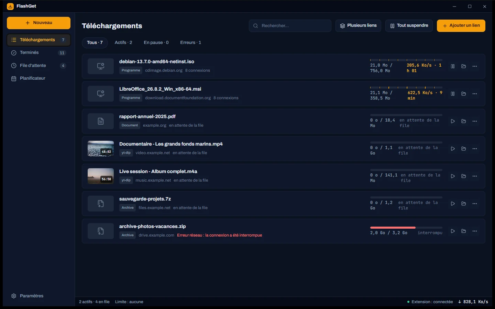
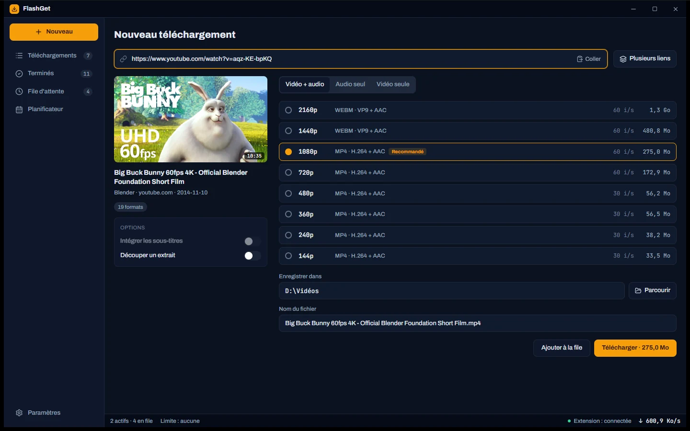
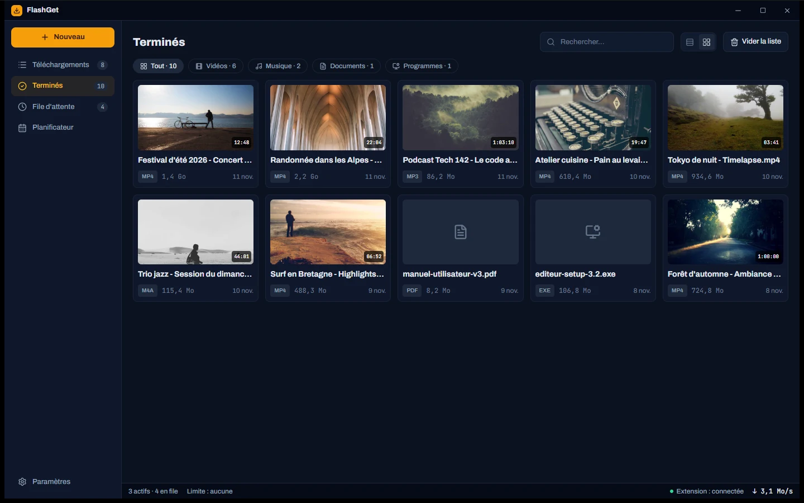

<p align="center">
  
</p>

<h1 align="center">FlashGet</h1>

<p align="center">
  Le gestionnaire de téléchargements pour Windows.<br>
  Plusieurs connexions par fichier, vidéos de plus de mille sites, reprise automatique, file d'attente, planificateur et extension navigateur.
</p>

<p align="center">
  <a href="https://github.com/jstephane98/FlashGet/releases/latest"><b>Télécharger pour Windows</b></a>
  &nbsp;·&nbsp;
  <a href="docs/presentation/FlashGet-presentation.html">Page de présentation</a>
  &nbsp;·&nbsp;
  <a href="https://github.com/jstephane98/FlashGet/releases">Notes de version</a>
</p>

<p align="center">
  
</p>

## Ce que fait FlashGet

**Télécharger vite**
- Chaque fichier est découpé en plusieurs morceaux téléchargés en parallèle, jusqu'à 32 connexions.
- Après une coupure réseau ou une erreur serveur, FlashGet réessaie avec un délai croissant et reprend là où il s'était arrêté.
- Limite de vitesse globale, plusieurs liens collés d'un coup, et un dossier de destination par type de fichier.

**Vidéo et audio**
- Plus de mille sites grâce à [yt-dlp](https://github.com/yt-dlp/yt-dlp), mis à jour automatiquement et vérifié par empreinte SHA-256.
- Choix de la qualité avant de télécharger, audio seul en MP3, M4A ou Opus, sous-titres, extraits, playlists entières.
- Flux HLS et DASH, à la demande ou en direct (enregistrement pendant la diffusion).

**Organiser**
- Une bibliothèque « Terminés » en liste ou en grille, avec vignettes, durées et un lecteur intégré.
- Une file d'attente que l'on réordonne par glisser-déposer, avec des priorités.
- Un planificateur : plage horaire, jours, limite de vitesse, puis veille ou arrêt quand tout est fini.

**Extension navigateur** (Chrome, Edge, Brave)
- Les téléchargements du navigateur arrivent dans FlashGet avec les cookies et la page d'origine.
- État réel de la connexion, sites ignorés partagés avec l'application, « Réessayer » qui renvoie le contexte de la capture.

**Au quotidien**
- Thème sombre, clair ou celui de Windows. Zone de notification, notifications de fin et d'échec, lancement au démarrage.
- Mises à jour de FlashGet signées : l'application prévient, rien ne s'installe sans votre clic.

<p align="center">
  
  
</p>

## Installer

1. Téléchargez `FlashGet_<version>_x64-setup.exe` depuis la [dernière version](https://github.com/jstephane98/FlashGet/releases/latest).
2. Lancez-le. L'installation se fait pour votre compte, sans droits administrateur. Windows SmartScreen peut afficher un avertissement, car l'installeur n'est pas signé par un certificat Windows : choisissez « Informations complémentaires », puis « Exécuter quand même ».
3. Pour l'extension, ouvrez FlashGet, puis **Paramètres › Extension navigateur**, et suivez les trois étapes. Le dossier de l'extension est fourni avec FlashGet.

Configuration requise : Windows 10 ou 11, 64 bits.

**Vous aviez FlashGet 0.1.0 ?** Fermez-le avant d'installer la 2.0. Au premier lancement, vos téléchargements, vos réglages, le jeton de l'extension et votre connexion YouTube sont repris automatiquement. Rechargez ensuite l'extension depuis la page des extensions du navigateur.

## Compiler depuis les sources

### Prérequis
- [Node.js](https://nodejs.org/) 20 ou plus récent.
- [Rust](https://www.rust-lang.org/tools/install) (stable) et les [prérequis Tauri 2 pour Windows](https://v2.tauri.app/start/prerequisites/) (Microsoft C++ Build Tools, WebView2).
- Les deux programmes embarqués, à placer dans `src-tauri/bin/` (ils ne sont pas dans le dépôt) :
  - `ffmpeg-x86_64-pc-windows-msvc.exe` : voir [src-tauri/bin/README.md](src-tauri/bin/README.md) ;
  - `yt-dlp-x86_64-pc-windows-msvc.exe` : le `yt-dlp.exe` de la [dernière version de yt-dlp](https://github.com/yt-dlp/yt-dlp/releases/latest), renommé.

### Commandes

```powershell
npm install
npm run tauri dev
```

| Commande | Rôle |
|---|---|
| `npm run tauri dev` | Lance FlashGet en mode développement |
| `npm test` | Tests de l'interface et de l'extension (Vitest) |
| `npx tsc --noEmit` | Vérification des types TypeScript |
| `cargo test --workspace` (dans `src-tauri`) | Tests du moteur et de l'application (Rust) |
| `npm run release` | Construit l'installeur signé et `latest.json` (voir [docs/RELEASE.md](docs/RELEASE.md)) |

Sur une machine avec peu de mémoire, limitez le parallélisme : `cargo test --workspace -j 1` et `npm test -- --maxWorkers=2`.

### Publier une version

La procédure complète (clé de signature, variables d'environnement, dépôt sur GitHub Releases) est décrite dans [docs/RELEASE.md](docs/RELEASE.md).

## Organisation du dépôt

| Dossier | Contenu |
|---|---|
| `src/` | Interface React 19 + TypeScript + Tailwind |
| `src-tauri/src/` | Application Tauri 2 : commandes, file d'attente, planificateur, pont avec l'extension, mises à jour |
| `src-tauri/crates/download-core/` | Moteur de téléchargement en Rust, sans dépendance à Tauri : segments, reprise, HLS et DASH, stockage SQLite |
| `extension/` | Extension navigateur (Manifest V3) |
| `scripts/` | Script de publication |
| `docs/` | Spécifications, plans, guide de publication et page de présentation |

## Composants intégrés

FlashGet embarque [yt-dlp](https://github.com/yt-dlp/yt-dlp) et [FFmpeg](https://ffmpeg.org/). Les captures de ce dépôt montrent des données de démonstration ; l'image de *Big Buck Bunny* est © Blender Foundation, sous licence [CC BY 3.0](https://creativecommons.org/licenses/by/3.0/).
